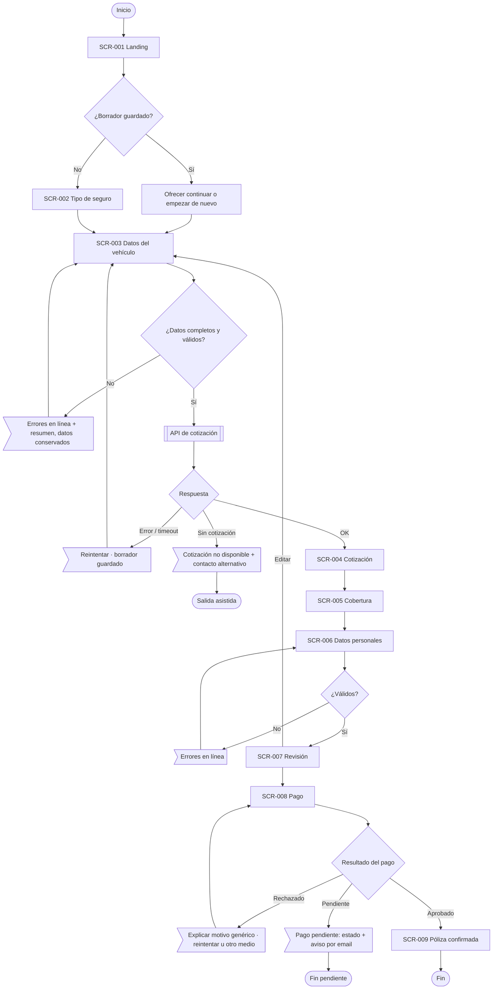
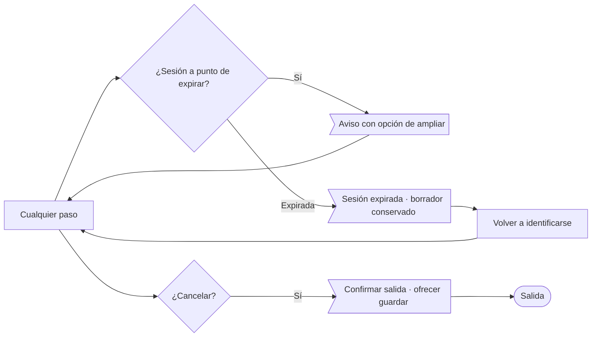

# Ejemplo — FLOW-001 Contratación de póliza de auto

Relacionado con: US-001 · Fuente: [insurance-user-story.md](insurance-user-story.md)

## Inventario de pantallas

| SCR | Pantalla | Paso |
|---|---|---|
| SCR-001 | Landing | Inicio |
| SCR-002 | Selección de seguro | 1 |
| SCR-003 | Información del vehículo (datos para cotizar) | 2 |
| SCR-004 | Resumen de cotización | 3 |
| SCR-005 | Selección de cobertura | 4 |
| SCR-006 | Datos personales | 5 |
| SCR-007 | Revisión y confirmación | 6 |
| SCR-008 | Pago | 7 |
| SCR-009 | Éxito / confirmación de póliza | Fin |

## Flujo principal y alternativos

### Caminos transversales (aplican a SCR-003…SCR-008)

## Descripción del flujo

| Paso | Pantalla | Acción del usuario | Respuesta del sistema | Regla | Error |
|---|---|---|---|---|---|
| 1 | SCR-002 | Elige "Automóvil" | Avanza a datos del vehículo | ASM-01 | — |
| 2 | SCR-003 | Introduce datos mínimos | Valida y llama a la API | DEC-01 | E1, E2, E3 |
| 3 | SCR-004 | Revisa precio orientativo | Muestra cotización y validez | — | — |
| 4 | SCR-005 | Elige cobertura | Recalcula precio si aplica | DEC-02 | E2 |
| 5 | SCR-006 | Introduce datos personales | Valida formato | — | E4 |
| 6 | SCR-007 | Revisa y acepta condiciones | Bloquea avance sin aceptación | WCAG 3.3.4 | — |
| 7 | SCR-008 | Paga | Procesa pago | DEC-03 | E5, E6 |
| 8 | SCR-009 | — | Emite póliza y envía confirmación | — | — |

## Trazabilidad de reglas de negocio

| Regla | Fuente | Se aplica en | Comportamiento | AC |
|---|---|---|---|---|
| BR-01 Campos obligatorios para cotizar | DEC-01 (pendiente) | SCR-003 | Bloqueo + mensajes | AC-001 |
| BR-02 Aceptación de condiciones antes de pagar | ASM (legal a confirmar) | SCR-007 | Checkbox obligatorio | AC-006 |
| BR-03 Conservación de datos ante error o timeout | REQ-006 / OPP-02 | SCR-003…SCR-008 | Borrador automático | AC-003, AC-004 |

## Reducción de fricción

- Pedir datos personales **después** de mostrar la cotización (H-01).
- Prellenar datos conocidos en usuarios identificados (WCAG 3.3.7 Redundant Entry).
- Paso de selección de seguro omitible mientras solo exista un producto (ASM-01) → DD-002.
