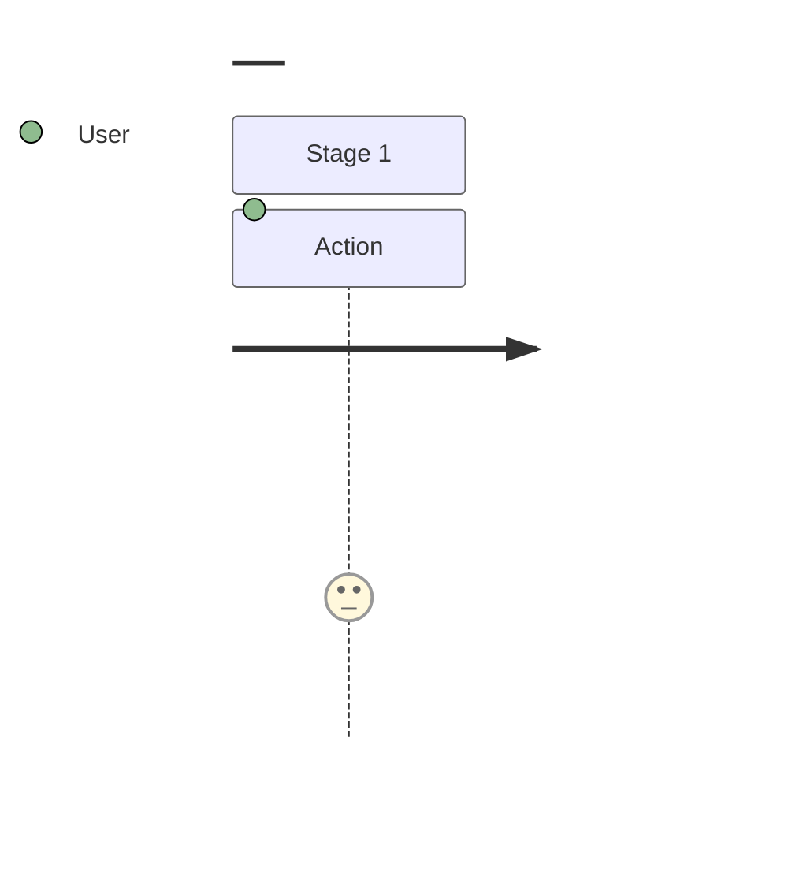

# User Journey — <Persona> · <Scenario> (AS-IS | TO-BE)

Evidence basis: <sources> · Emotion scores are hypothesized unless stated.

## Journey map

| | Stage 1 | Stage 2 | Stage 3 | Stage 4 |
|---|---|---|---|---|
| User goal | | | | |
| Actions | | | | |
| Touchpoints | | | | |
| Thoughts | | | | |
| Emotion (−2…+2) | | | | |
| Pain points | | | | |
| Opportunities | | | | |

## Diagram

## Pain Points Matrix

| ID | Stage | Pain point | Evidence | Severity (1–4) | Frequency | Persona |
|---|---|---|---|---|---|---|

## Opportunity Backlog

| ID | Opportunity | Addresses | Impact hypothesis | Effort | Priority | Validation |
|---|---|---|---|---|---|---|

Prioritization method used: <ICE / MoSCoW> — reason:
