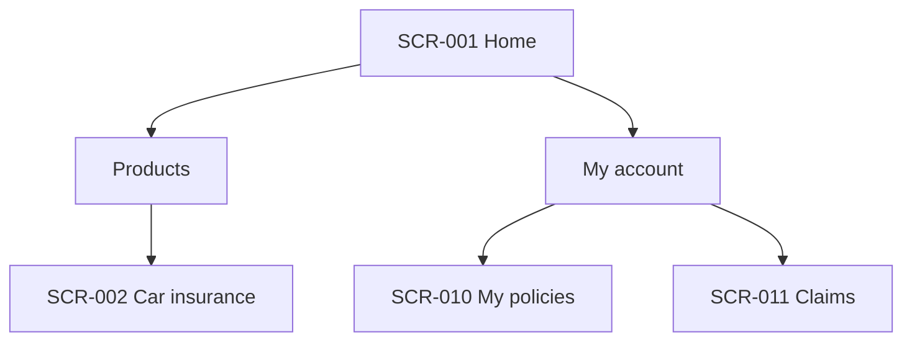

# Module 03 — Information Architecture

Goal: a structure users can understand, navigate and that scales with the product.

## Process

1. **Content inventory** — list every content type and function (from requirements, sitemap,
   code routes or screenshots). Flag duplicates and orphans.
2. **Mental model** — group by user task and vocabulary, not org chart or database schema.
3. **Hierarchy** — limit primary navigation to the user's top tasks (typically 5–7 items); depth
   ≤ 3 levels for frequent tasks.
4. **Labels** — user language, mutually exclusive, front-loaded keywords; avoid internal jargon.
5. **Navigation systems** — global, local, contextual, utility, breadcrumbs, search.
6. **Findability & cognitive load review** — can each top task be reached in ≤ 3 meaningful
   decisions? Is any label ambiguous?
7. **Validation plan** — open card sort (discover groupings), closed card sort (validate groups),
   tree testing (validate findability, success target set as a threshold to test).

## Sitemap (Mermaid)

Node IDs match `SCR-n` when the screen is defined. Fallback without Mermaid: indented list.

## Navigation rationale

For each top-level item record: user task served, evidence, why this label, expected frequency,
alternatives considered. Store significant choices as `DD-n`.

## Anti-patterns to flag

- Navigation mirroring internal departments.
- "Miscellaneous", "Other", "Resources" buckets hiding top tasks.
- Same content reachable under different labels.
- Hover-only menus (inaccessible on touch and keyboard).
- Mega-menus without headings / landmark structure.

## Deliverables

Information Architecture Document, Sitemap, Navigation Structure, Content Hierarchy, Navigation
Rationale.
