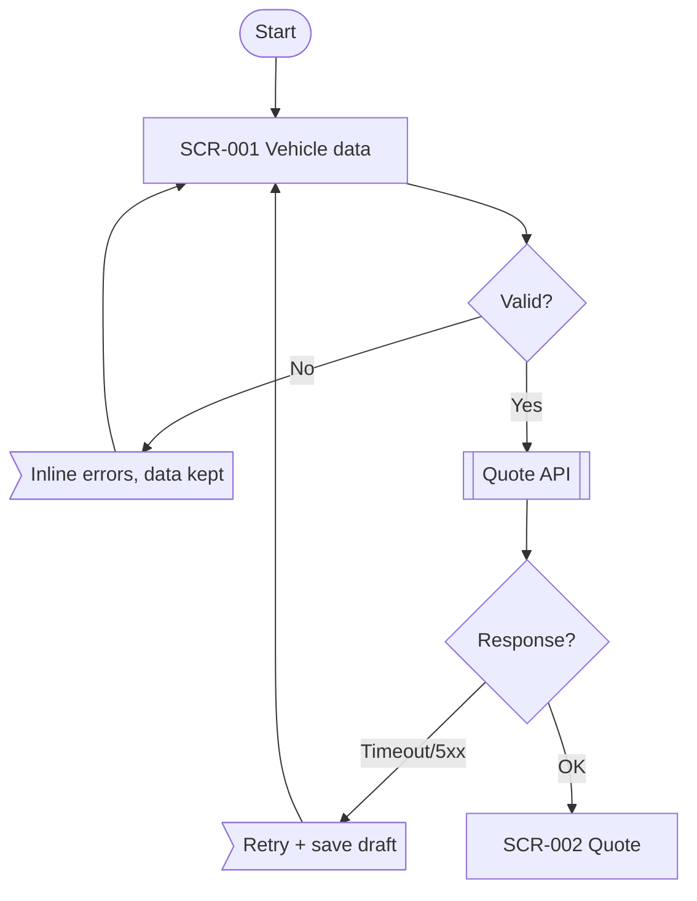

# Module 04 — User Flow Generator

Goal: turn user stories and business processes into complete interaction flows, including the
unhappy paths.

## Process

1. **Entry points** — where users start (deep link, home, notification, email, search).
2. **Happy path** — minimal steps to the goal.
3. **Decisions** — every branch the user or system makes.
4. **Alternative paths** — legitimate variations (returning user, saved draft, different product).
5. **Error and recovery paths** — validation, system/API failure, timeout, session expiry,
   authorization, cancellation, resumption.
6. **Business rules** — each rule as `BR-n`, linked to the step that enforces it. If a rule is not
   provided, do **not** invent it; add `ASM-n` or `DEC-n — PENDING`.
7. **Dependencies** — APIs, external systems, auth; note latency and failure behavior.
8. **Friction review** — remove steps that do not serve the user or a stated rule; defer optional
   data; prefill known data.
9. **Exits** — success, abandonment, handoff to another channel.

## Mermaid conventions

- Use `flowchart TD` (or `LR` for short linear flows).
- Node shapes: `([Start/End])`, `[Screen / step]`, `{Decision?}`, `[[System / API]]`,
  `>Error state]`.
- IDs: screens use `SCR###`; decisions `D#`; errors `E#`. Labels in the user's language.
- Keep one flow ≤ ~25 nodes; split into sub-flows (`FLOW-001a`) beyond that.
- Validate syntax mentally: quote labels containing parentheses, colons or accents if needed
  (`A["Datos (opcional)"]`).

## Flow description table

| Step | Screen | User action | System response | Rule | Error path |
|---|---|---|---|---|---|

## Business Rules Traceability

| Rule | Source | Enforced at | Error message / behavior | AC |
|---|---|---|---|---|
| BR-01 | REQ-003 [SRC-1] | SCR-003 step 2 | … | AC-004 |

## Unhappy-path checklist

Incomplete data · invalid format · duplicate submission · API failure / timeout · no results ·
session expired · unauthorized / forbidden · payment declined / pending · user cancels · user
returns later (resume) · offline / slow network · back button / refresh mid-flow.

## Deliverables

User Flow Diagram, Decision Flow, Error Recovery Flow, Flow Description, Business Rules
Traceability.
