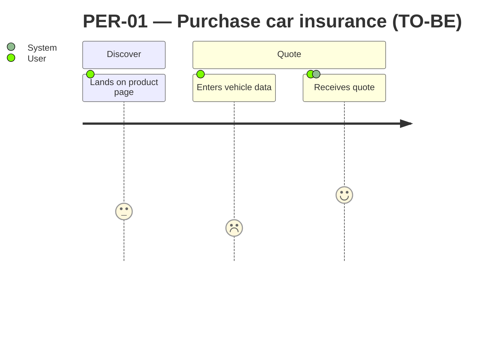

# Module 02 — User Journey Mapping

Goal: represent the end-to-end experience, locate friction and turn it into prioritized
opportunities.

## Structure

For each persona and scenario, map stages left to right. Each stage has:

| Row | Content |
|---|---|
| Stage | Aware → Consider → Act → Use → Support (adapt to domain) |
| User goal | What the user wants at this stage |
| Actions | What they do |
| Touchpoints | Channel / screen / person (`SCR-n` when known) |
| Thoughts | Paraphrased, labelled `[ASSUMPTION]` unless from research |
| Emotion | −2 … +2 (hypothesized unless measured) |
| Pain points | `PP-n` |
| Opportunities | `OPP-n` |

## AS-IS vs TO-BE

- **AS-IS**: the current experience, only from evidence (provided flows, screenshots, user reports)
  or explicitly labelled assumptions.
- **TO-BE**: the proposed experience. Every change must trace to a pain point or need and to a
  business goal.

## Mermaid

Scores in `journey` diagrams are hypothesized emotion (1–5); say so in the caption.

## Pain Points Matrix

| ID | Stage | Pain point | Evidence | Severity (1–4) | Frequency | Affected persona |
|---|---|---|---|---|---|---|

## Opportunity Backlog

Every opportunity needs priority, rationale and impact hypothesis.

| ID | Opportunity | Addresses | Impact hypothesis | Effort (S/M/L) | Priority | Validation |
|---|---|---|---|---|---|---|
| OPP-01 | Save progress automatically | PP-03 | Reduces abandonment after interruptions [HYPOTHESIS] | M | High | A/B or usability test |

Prioritization: impact × confidence ÷ effort (ICE) or MoSCoW; state which one and why.
Confidence is Low when the pain point is an assumption.

## Deliverables

Customer Journey Map, AS-IS Journey, TO-BE Journey, Pain Points Matrix, Opportunity Backlog.
Template: `assets/templates/user-journey-template.md`.
